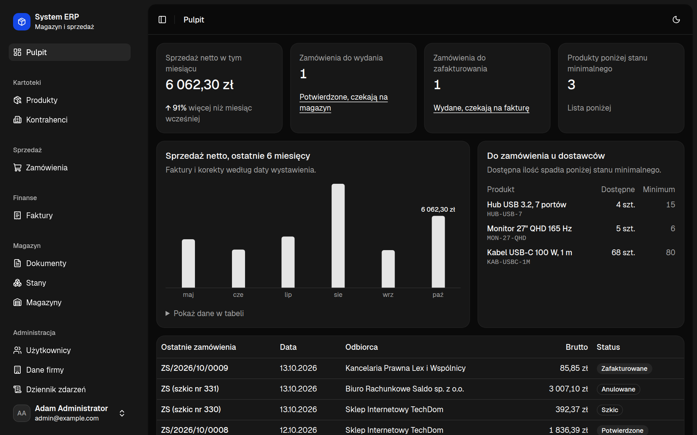
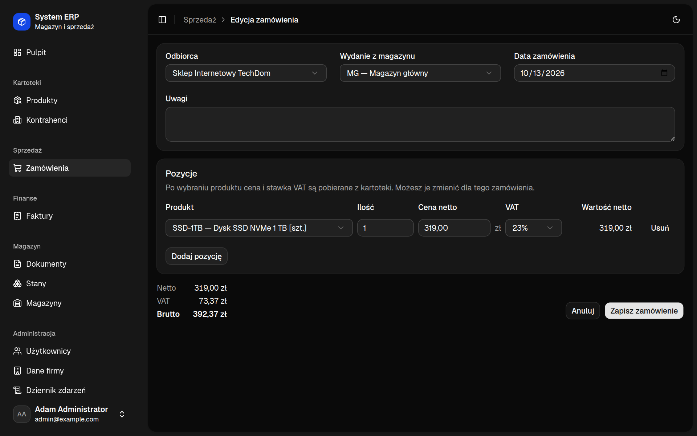
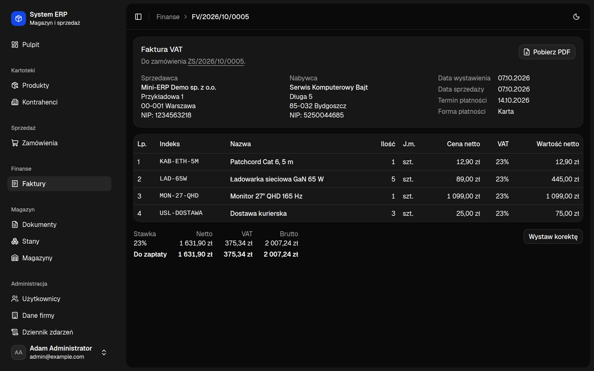
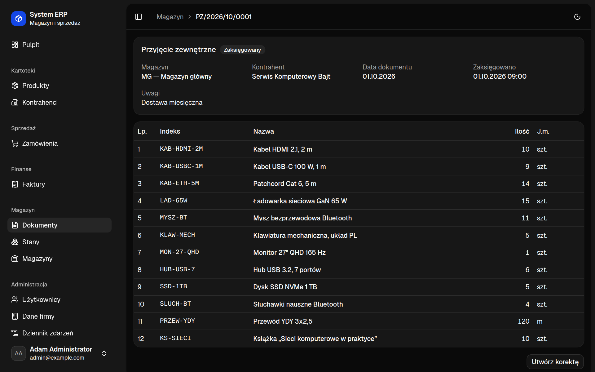
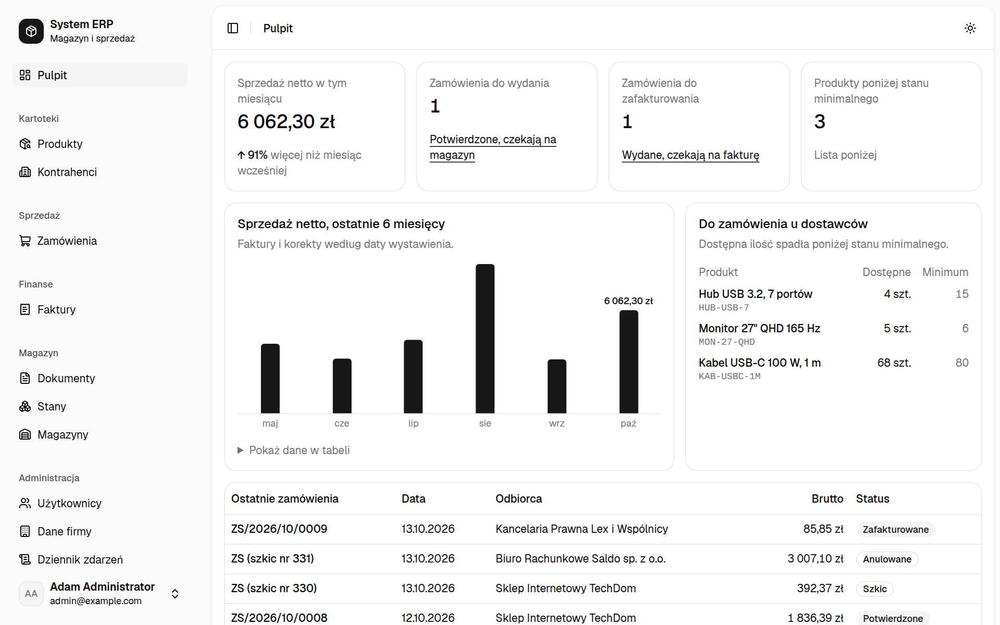
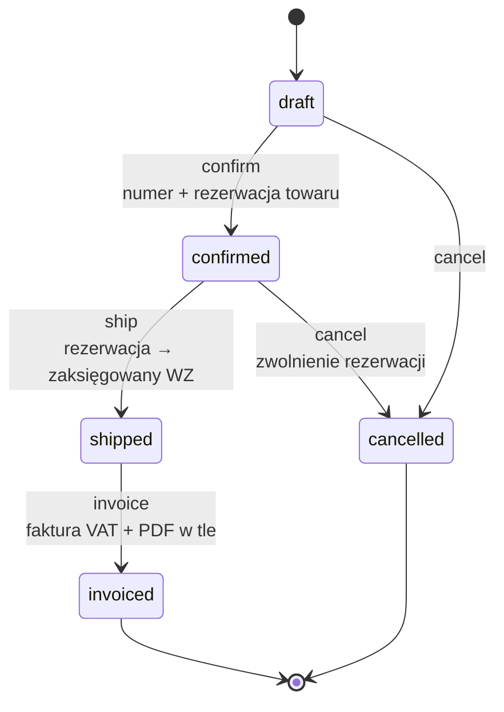
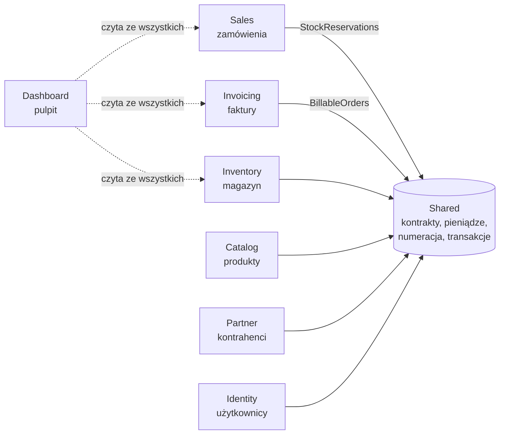
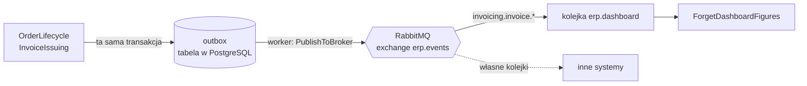

# System ERP

System do obsługi sprzedaży hurtowej: od przyjęcia towaru, przez zamówienie i wydanie, po fakturę VAT. Modularny monolit w Symfony 8.1, napisany jako projekt do portfolio.

**Demo: https://systemerp.tojest.dev** (konta w sekcji [Konta demo](#konta-demo)). Działa w Kubernetesie (k3s) i jest wdrażane przez Argo CD, opis w [docs/wdrozenie.md](docs/wdrozenie.md).

Nie jest to zbiór formularzy CRUD. Pilnuje reguł, które w takim systemie naprawdę bolą: nie da się wydać towaru, którego nie ma, dwa jednoczesne wydania nie przejdą oba, zaksięgowanego dokumentu nie można zmienić, a faktura i jej korekty zawsze sumują się co do grosza.



| | |
|---|---|
|  |  |
| Zamówienie: pozycje, ceny z kartoteki i sumy odświeżane na żywo | Faktura z PDF-em generowanym w tle |
|  |  |
| Zaksięgowane przyjęcie towaru | Tryb jasny |

## Co potrafi

Jeden proces, cztery role:

1. **Magazynier** przyjmuje dostawę dokumentem PZ. Zaksięgowanie zwiększa stany i nadaje numer.
2. **Handlowiec** wystawia zamówienie i je potwierdza. Potwierdzenie rezerwuje towar; jeśli go brakuje, system mówi, czego i ile.
3. **Magazynier** wydaje zamówienie. Rezerwacja zamienia się w zaksięgowany dokument WZ.
4. **Księgowa** wystawia fakturę VAT. PDF powstaje w tle, a pomyłkę naprawia faktura korygująca.

Do tego kartoteki produktów i kontrahentów, przesunięcia między magazynami, historia ruchów każdego produktu i pulpit z tym, co czeka na każdą z ról.

**Administrator** zarządza kontami (zakłada, nadaje role, ustawia hasła, blokuje), zmienia dane firmy drukowane na fakturach i przegląda dziennik zdarzeń: kto i kiedy się zalogował, zaksięgował dokument, wystawił fakturę albo zmienił cenę produktu (razem z wartością przed i po).

### Cykl życia zamówienia



Dozwolone przejścia definiuje workflow `sales_order` (`config/packages/workflow.yaml`), a ich skutki w magazynie i dzienniku zdarzeń wykonuje `App\Sales\Service\OrderLifecycle`.

## Architektura

Każdy moduł leży w `src/<Moduł>` i nie widzi encji pozostałych. Przechowuje tylko ich identyfikatory, a o resztę pyta przez interfejsy z `Shared`, które implementuje moduł-właściciel. Granic pilnuje Deptrac w `make lint`.



| Moduł | Zakres |
|-------|--------|
| `Identity` | logowanie, role, zarządzanie kontami, „Moje konto” |
| `Catalog` | produkty i usługi, ceny, stawki VAT, stany minimalne |
| `Partner` | kontrahenci (odbiorcy i dostawcy), walidacja NIP |
| `Inventory` | magazyny, dokumenty PZ/WZ/MM, rejestr ruchów, stany, rezerwacje |
| `Sales` | zamówienia sprzedaży i ich cykl życia |
| `Invoicing` | faktury VAT, korekty, PDF, dane firmy |
| `Dashboard` | pulpit i dziennik zdarzeń; jedyny moduł, który czyta ze wszystkich |
| `Shared` | kontrakty między modułami, `Money`, VAT, numeracja dokumentów, transakcje, zapis dziennika zdarzeń |

Kontrakty: `ProductDirectory`, `PartnerDirectory`, `WarehouseDirectory` (odczyt kartotek), `StockReservations` (sprzedaż → magazyn), `BillableOrders` (faktury → sprzedaż).

### Budowa modułu

Wszystkie moduły mają ten sam układ katalogów:

| Katalog | Zawartość |
|---|---|
| `Controller` | Cienkie kontrolery (`AbstractController`). Routing, uprawnienia i CSRF są atrybutami (`#[Route]`, `#[IsGranted]`, `#[IsCsrfTokenValid]`), a parametry list (filtry, strona) wiąże `#[MapQueryString]` z obiektem DTO. |
| `Dto` | Filtry list (`OrderFilter`, `ProductFilter` …) i dane formularzy (`OrderDraft`, `IssueInvoice`, `DocumentHeader`) z walidacją `#[Assert\…]` |
| `Entity` | Encje Doctrine z zachowaniem (np. `block()`, przejścia statusów), a nie tylko gettery i settery |
| `Form` | Formularze Symfony Form dla ekranów edycji |
| `Repository` | Zapytania, wyszukiwanie ze stronicowaniem, blokady wierszy |
| `Service` | Operacje biznesowe: jedna metoda to jedna transakcja (np. `OrderLifecycle::confirm()`, `InvoiceIssuing`, `StockPosting`) |
| `Twig` | Live Components i komponenty Twig należące do modułu |
| `Message` | Wiadomości Messengera i ich handlery (tylko `Invoicing`) |

Tabele mają prefiks modułu (`identity_user`, `inventory_stock_level`, `shared_document_sequence`), więc w bazie od razu widać, kto jest właścicielem danych. Schemat zmienia się wyłącznie migracjami Doctrine (`migrations/`).

### Kontrakty między modułami

Interfejs leży w `Shared`, a implementuje go moduł, który jest właścicielem danych. Autowiring podpina implementację, więc moduł korzystający z kontraktu nie zna nawet nazwy klasy po drugiej stronie.

| Kontrakt (`src/Shared/…`) | Implementacja | Kto korzysta |
|---|---|---|
| `Catalog\ProductDirectory` | `Catalog\Service\DoctrineProductDirectory` | Inventory, Sales, Invoicing, Dashboard |
| `Partner\PartnerDirectory` | `Partner\Service\DoctrinePartnerDirectory` | Inventory, Sales, Invoicing, Dashboard |
| `Inventory\WarehouseDirectory` | `Inventory\Service\DoctrineWarehouseDirectory` | Sales |
| `Inventory\StockReservations` | `Inventory\Service\OrderStock` | Sales: rezerwacja, zwolnienie, wydanie |
| `Sales\BillableOrders` | `Sales\Service\DoctrineBillableOrders` | Invoicing: odczyt zamówienia do faktury, oznaczenie jako zafakturowane |

Kontrakty zwracają proste, niemutowalne obiekty (`ProductSummary`, `PartnerSummary`, `BillableOrder`, `Shipment`), a nie encje. Reguły zależności są w `deptrac.yaml`: każdy moduł widzi tylko `Shared`, a `Dashboard` jako jedyny może czytać z pozostałych.

## Reguły, których pilnuje kod

### Magazyn

- Dokument powstaje jako szkic i nie zmienia stanów. Zmienia je dopiero zaksięgowanie, po którym dokumentu nie da się edytować ani usunąć; pomyłkę naprawia dokument korygujący.
- Stan magazynowy jest sumą ruchów. Ruchy są tylko dopisywane, a stan jest aktualizowany w tej samej transakcji (`StockPosting`).
- Nie da się wydać więcej, niż jest dostępne (stan minus rezerwacje). Wiersze stanów są blokowane na czas księgowania, więc dwa jednoczesne wydania tego samego towaru nie przejdą oba.
- Numery (`PZ/2026/10/0001`) są nadawane przy księgowaniu, osobno dla typu i miesiąca, bez dziur: odrzucona operacja nie zużywa numeru.

### Sprzedaż

- Zamówienie przechodzi przez statusy z workflow `sales_order` (`config/packages/workflow.yaml`): szkic → potwierdzone → wydane → zafakturowane, z anulowaniem przed wydaniem.
- Każdy krok to jedna transakcja obejmująca zamówienie i magazyn (`OrderLifecycle`). Anulowanie zwalnia rezerwację.
- Ceny i stawki VAT są kopiowane na pozycję, więc późniejsze zmiany w kartotece nie zmieniają zamówienia.
- Formularz zamówienia to Live Component (`App\Sales\Twig\OrderEditor`), bez własnego JavaScriptu.

### Faktury

- Jedna faktura na wydane zamówienie. Wystawienie to jedna transakcja: numer, zapis faktury i zmiana statusu zamówienia.
- Faktura jest migawką: sprzedawca, nabywca, pozycje i sumy są na nią kopiowane i już się nie zmieniają.
- Faktura korygująca zmniejsza ilości i pokazuje „było / jest / różnica”. Jej VAT to różnica między VAT-em dokumentu przed i po, dzięki czemu faktura i korekty zawsze sumują się co do grosza.
- PDF generuje worker Messengera. Wiadomość trafia do kolejki w tej samej transakcji bazy co faktura, a strona sama odświeża status, aż plik będzie gotowy.

### Konta i administracja

- Nie ma osobnego modułu „admin”. Każdy moduł dostarcza własne ekrany administracyjne, a menu „Administracja” tylko je grupuje dla roli administratora.
- Kont się nie usuwa, tylko blokuje: dokumenty i dziennik dalej na nie wskazują. Zablokowany użytkownik nie zaloguje się, a jego trwająca sesja kończy się przy następnym żądaniu. To samo dzieje się po zmianie hasła lub ról.
- Po pięciu nieudanych logowaniach na jedno konto z jednego adresu kolejne próby są odrzucane przez 15 minut, nawet z poprawnym hasłem (`login_throttling`). Blokada trafia do dziennika raz, a nie przy każdej następnej próbie.
- Administrator może pracować jako inny użytkownik („Podszywaj się” na liście kont), żeby zobaczyć system jego oczami. Na każdej stronie widać wtedy pasek z powrotem do własnego konta, a dziennik zapisuje administratora: „Adam Administrator (jako Hanna Handlowiec)”.
- Administrator nie może zablokować siebie ani odebrać sobie roli, a w systemie zawsze zostaje przynajmniej jeden aktywny administrator.
- Dziennik zdarzeń obejmuje operacje na dokumentach, zmiany w kartotekach, konta i logowania (także nieudane). Zmiany w kartotekach zapisuje automatycznie nasłuch Doctrine (`AuditListener`) dla encji oznaczonych interfejsem `Audited`, więc żadna edycja go nie ominie.
- Wpis w dzienniku zdarzeń zapisuje się w tej samej transakcji co operacja, więc dziennik nigdy nie wspomina o czymś, co zostało wycofane.

### Pieniądze i ilości

- Kwoty są liczbami całkowitymi w groszach (`App\Shared\Money\Money`), ilości w tysięcznych częściach jednostki. Żadnych ułamków zmiennoprzecinkowych.
- VAT jest liczony od sumy netto w każdej stawce, z zaokrągleniem „od połowy w górę”, w jednym miejscu w kodzie.

## Rozwiązania techniczne

Jak powyższe reguły są zrealizowane i gdzie tego szukać w kodzie.

### Transakcje

Każda operacja biznesowa przechodzi przez `App\Shared\Persistence\Transactional::run()`. Otwiera on transakcję, wykonuje pracę, robi `flush()` i zatwierdza. Rozróżnia dwa rodzaje porażki:

- `\DomainException` oznacza, że reguła biznesowa odmówiła (np. brak towaru). Transakcja jest wycofywana, ale `EntityManager` zostaje otwarty, więc kontroler może pokazać użytkownikowi powód i normalnie wyrenderować stronę.
- Każdy inny błąd wycofuje transakcję i zamyka `EntityManager`, tak jak zwykle robi to Doctrine.

Wywołania można zagnieżdżać. Wewnętrzne stają się savepointami transakcji zewnętrznej, więc np. `OrderLifecycle` może wywołać magazyn, a całość i tak zatwierdza się albo cofa razem.

### Współbieżność w magazynie

Problem: dwóch magazynierów jednocześnie wydaje ostatnią sztukę towaru. Rozwiązanie w `Inventory\Repository\StockLevelRepository::lockForUpdate()`:

1. Brakujące wiersze stanów są zakładane przez `INSERT … ON CONFLICT DO NOTHING`. Dzięki temu nie ma wyścigu nawet wtedy, gdy wiersz zakłada w tej chwili inna transakcja.
2. Wiersze są blokowane `SELECT … FOR UPDATE` (`LockMode::PESSIMISTIC_WRITE`) **zawsze w tej samej kolejności** (magazyn, produkt). Dwie transakcje dotykające tych samych produktów czekają na siebie zamiast się zakleszczyć.
3. Dopiero po zablokowaniu sprawdzana jest dostępność (stan minus rezerwacje), z danymi świeżo odczytanymi z bazy (`HINT_REFRESH`).

Tak samo blokowane są dokumenty, zamówienia i faktury korygowane (`refresh($encja, LockMode::PESSIMISTIC_WRITE)`), więc dwa kliknięcia „Zaksięguj” albo „Wydaj” nie wykonają operacji dwa razy.

### Numeracja bez dziur

`App\Shared\Numbering\DocumentNumberGenerator` trzyma licznik w tabeli `shared_document_sequence` (seria, rok, miesiąc) i zwiększa go jednym poleceniem PostgreSQL `INSERT … ON CONFLICT … DO UPDATE … RETURNING`. Licznik:

- działa tylko w aktywnej transakcji, a wywołanie bez niej rzuca wyjątek;
- pozostaje zablokowany do końca transakcji, więc dwa dokumenty nie dostaną tego samego numeru;
- przy wycofaniu transakcji cofa się razem z nią, więc nie powstają dziury w numeracji.

Sekwencje PostgreSQL (`SEQUENCE`) nie spełniłyby ostatniego warunku, bo nie cofają się przy rollbacku.

### Kolejka i PDF w tle (transactional outbox)

Generowanie PDF-a jest wolne, więc nie dzieje się w żądaniu HTTP:

1. `Invoicing\Service\InvoiceIssuing` zapisuje fakturę i wysyła wiadomość `GenerateInvoicePdf`. Messenger używa transportu Doctrine, więc wiadomość jest wierszem w tej samej bazie i **w tej samej transakcji** co faktura. Nie ma sytuacji „faktura jest, a wiadomości nie ma” ani odwrotnie. To wzorzec transactional outbox bez osobnego brokera.
2. Worker (`messenger:consume async`) wywołuje `GenerateInvoicePdfHandler`: renderuje PDF (dompdf) i zapisuje plik przez `InvoicePdfStorage`. Zapis idzie przez `Filesystem::dumpFile()`, czyli do pliku tymczasowego i potem `rename`, więc nikt nie pobierze niedokończonego PDF-a.
3. Status faktury zmienia się na `Ready` albo `Failed`. Błąd jest ponawiany 3 razy z rosnącym odstępem (`retry_strategy` w `config/packages/messenger.yaml`), a po wyczerpaniu prób wiadomość trafia do transportu `failed`. Brak faktury to `UnrecoverableMessageHandlingException`, bo ponawianie nic by nie dało.
4. Na stronie faktury Live Component `Invoicing\Twig\PdfStatus` co 1,5 s pyta serwer o status (`data-poll`) i sam zamienia się w link do pobrania, gdy plik jest gotowy.

Asynchronicznie wysyłane są też maile i powiadomienia Notifiera.

### Zdarzenia biznesowe i RabbitMQ

Moduły i systemy zewnętrzne (sklep, wyszukiwarka, hurtownia danych) dowiadują się o zmianach ze zdarzeń, a nie przez odpytywanie bazy. Zdarzenia leżą w `App\Shared\Event`, bo widzi je każdy moduł:

| Zdarzenie | Klucz routingu | Kto je wysyła |
|---|---|---|
| `OrderConfirmed` | `sales.order.confirmed` | `Sales\Service\OrderLifecycle::confirm()` |
| `OrderShipped` | `sales.order.shipped` | `OrderLifecycle::ship()` |
| `OrderCancelled` | `sales.order.cancelled` | `OrderLifecycle::cancel()` |
| `InvoiceIssued` | `invoicing.invoice.issued` | `Invoicing\Service\InvoiceIssuing` (faktura i korekta) |



1. **Outbox.** Zdarzenie jest wysyłane w transakcji, która zmienia dane, i trafia do transportu `outbox`, czyli do tabeli w tej samej bazie. Wysyłka prosto do RabbitMQ mogłaby się udać przy wycofanej transakcji (świat dowiaduje się o zamówieniu, którego nie ma) albo nie udać przy zatwierdzonej (zdarzenie ginie). Wiersz w tej samej transakcji istnieje dokładnie wtedy, gdy zmiana.
2. **Przekaźnik.** Worker czyta outbox, a `Shared\Event\PublishToBroker` publikuje zdarzenie do exchange'a `erp.events` (typ topic) z kluczem z `routingKey()`. Gdy broker nie działa, wiersz czeka i jest ponawiany przez około godzinę. Handler ma `fromTransport: 'outbox'`, więc zdarzenie odebrane z RabbitMQ nie wraca do brokera w pętli.
3. **Format.** Zdarzenia przechodzą jako JSON (`messenger.transport.symfony_serializer`), z prostymi wartościami: identyfikatory, numery, kwoty w groszach, daty w ISO 8601. Odbiorca nie musi być napisany w PHP. Opublikowanego pola nie zmienia się ani nie usuwa.
4. **Subskrybenci.** Każdy ma własną kolejkę powiązaną z kluczami, które go interesują (`sales.order.*`, `invoicing.#`). ERP sam subskrybuje kolejkę `erp.dashboard`: `Dashboard\Message\ForgetDashboardFigures` po każdej fakturze usuwa z Redisa zapamiętaną sprzedaż.
5. **Co najmniej raz.** Zdarzenie może rzadko dotrzeć dwa razy (opublikowane, ale worker padł przed potwierdzeniem wiersza), więc subskrybenci działają idempotentnie. Błąd subskrybenta jest ponawiany przez kolejki opóźnień RabbitMQ, a potem trafia do transportu `failed`.

Kolejki i wiadomości podgląda się w panelu RabbitMQ: lokalnie adres wypisuje `symfony var:export RABBITMQ_MANAGEMENT_URL` (login `guest`/`guest`), a w klastrze `kubectl -n system-erp exec system-erp-rabbitmq-0 -- rabbitmqctl list_queues`.

### Redis: cache i sesje

Wspólny stan wszystkich kopii aplikacji (dwa pody web i worker) jest w Redisie, a nie w tabelach PostgreSQL:

- **Sesje** (`framework.session.handler_id`). Każde żądanie zalogowanego użytkownika czyta sesję, więc baza ma o tyle mniej pracy. Redis sam usuwa wygasłe sesje.
- **Cache aplikacji** (`cache.app`, adapter `redis_tag_aware`), a w nim liczniki nieudanych logowań z `login_throttling` i cache wyników Doctrine.
- **Wyliczenia pulpitu** (pula `dashboard.cache`). Sprzedaż z sześciu miesięcy to agregacja po całej tabeli faktur. `DashboardReport` zapamiętuje ją z tagiem `dashboard.sales`, a zdarzenie `InvoiceIssued` usuwa wszystko z tym tagiem. Nowa faktura pojawia się na pulpicie po około sekundzie, gdy worker przekaże zdarzenie.

Blokady (`LOCK_DSN`) zostały w PostgreSQL: blokada advisory działa w tej samej bazie co transakcje, które chroni. W klastrze Redis zapisuje dane na dysk (AOF), więc restart nie wylogowuje użytkowników. Przy braku pamięci usuwa tylko wpisy z terminem ważności (`volatile-lru`), bo listy tagów cache Symfony muszą zostać.

### Maszyna stanów zamówienia

Statusy i dozwolone przejścia są konfiguracją (Symfony Workflow, `type: state_machine`), a nie rozproszonymi `if`-ami. `OrderLifecycle` przed każdą operacją blokuje zamówienie i sprawdza `workflow->can()`, potem wykonuje skutki uboczne (rezerwacja, WZ, wpis w dzienniku) i dopiero na końcu `workflow->apply()`, wszystko w jednej transakcji.

### Pieniądze i VAT

`App\Shared\Money\Money` to niemutowalny obiekt wartości na liczbach całkowitych (grosze). `App\Shared\Tax\VatBreakdown` grupuje pozycje według stawki i liczy VAT od sumy netto w każdej stawce, a nie od każdej pozycji osobno. Na tym polega różnica między „suma się zgadza” a „suma różni się o grosz”. Korekta liczy VAT jako różnicę zestawień przed i po, a nie VAT od różnicy.

### Dziennik zdarzeń

- Operacje biznesowe zapisują wpis jawnie przez `App\Shared\Audit\ActivityLog`.
- Zmiany kartotek łapie `AuditListener` (zdarzenia Doctrine `onFlush` i `postFlush`) dla każdej encji z interfejsem `Audited`, razem z wartościami przed i po. Nikt nie musi pamiętać o wywołaniu logu.
- Wpisy idą tym samym połączeniem, więc są zatwierdzane albo cofane razem z danymi.
- Autorem wpisu jest `Actor`. Podczas podszywania się jest to `ImpersonatingActor`, który zapisuje administratora i osobę, w której imieniu działał.

### Bezpieczeństwo

- **Role stanowiskowe i uprawnienia.** Użytkownik dostaje rolę stanowiska (`ROLE_WAREHOUSE`, `ROLE_SALES`, `ROLE_ACCOUNTING`, `ROLE_ADMIN`), a kod sprawdza uprawnienia do edycji (`ROLE_INVENTORY_EDIT`, `ROLE_SALES_EDIT` …). Mapowanie jest w `role_hierarchy` w `config/packages/security.yaml`, więc zmiana zakresu stanowiska nie wymaga zmian w kodzie.
- **Blokada konta.** `Identity\Security\UserChecker` sprawdza blokadę **po** weryfikacji hasła, żeby informację „konto zablokowane” dostał tylko ktoś, kto zna hasło.
- **Unieważnianie sesji.** `User` implementuje `EquatableInterface`. Po zmianie hasła, ról albo zablokowaniu konta użytkownik z otwartą sesją zostaje wylogowany przy następnym żądaniu.
- **Ochrona logowania.** `login_throttling` (5 prób na 15 minut, osobny limit na adres IP), CSRF w formularzu logowania, przy wylogowaniu i przy każdej akcji zmieniającej dane.
- **Podszywanie się** to standardowy `switch_user` firewalla, dostępny tylko dla `ROLE_ADMIN`.

### Interfejs bez własnego JavaScriptu

- **Live Components** (`OrderEditor`, `PdfStatus`): formularz zamówienia przelicza ceny i sumy na serwerze przy każdej zmianie, a status PDF-a odświeża się sam.
- **Turbo** daje nawigację bez przeładowania strony, a **Stimulus** obsługuje drobne zachowania.
- **AssetMapper + Tailwind CSS 4** działają bez Node, npm i bundlera. CSS buduje samodzielna binarka Tailwinda w wersji przypiętej w `config/packages/symfonycasts_tailwind.yaml`.
- Komponenty Twig (przyciski, karty, tabele, dialogi) pochodzą z Symfony UX Toolkit i leżą w `templates/components/`.

## Uruchomienie

Wymagania: PHP 8.5 z rozszerzeniami `redis` i `amqp` (Ubuntu: `sudo apt install php8.5-redis php8.5-amqp`), Composer, [Symfony CLI](https://symfony.com/download), Docker.

```bash
composer install
make up      # Postgres, Redis, RabbitMQ i Mailpit w Dockerze
make db      # baza i migracje
make demo    # dane demonstracyjne (czyści bazę deweloperską!)
make serve   # serwer; w tle przebudowuje CSS i obsługuje kolejki
```

`make serve` uruchamia serwer na pierwszym wolnym porcie, zwykle http://127.0.0.1:8000. Adres pokaże też `symfony server:status`. Listę wszystkich poleceń wypisuje `make help`.

Kontenery wystawiają porty losowo, więc nie gryzą się z innymi projektami. Symfony CLI sam je odczytuje i przekazuje aplikacji jako `DATABASE_URL`, `REDIS_URL`, `RABBITMQ_DSN` i `MAILER_DSN`, dlatego polecenia konsoli uruchamia się przez `symfony console`, a nie przez `php bin/console`. Maile wysłane przez aplikację przechwytuje Mailpit. Jego panel jest dostępny z paska debugowania Symfony.

### Konta demo

Tworzy je `make demo`. Proste hasła, tylko do użytku lokalnego.

| Rola | E-mail | Hasło | Co może |
|---|---|---|---|
| Administrator | `admin@example.com` | `admin12345` | wszystko, w tym konta, dane firmy i dziennik zdarzeń |
| Magazynier | `magazyn@example.com` | `magazyn12345` | dokumenty magazynowe, wydanie zamówień, produkty |
| Handlowiec | `sprzedaz@example.com` | `sprzedaz12345` | zamówienia, produkty, kontrahenci |
| Księgowość | `ksiegowosc@example.com` | `ksiegowosc12345` | faktury i korekty, kontrahenci |

Każdy zalogowany może przeglądać wszystko; role decydują o tym, kto co zmienia.

Dane demo to pół roku pracy hurtowni elektroniki: dostawy, kilkadziesiąt zamówień i faktur, a na koniec kilka zamówień w toku i produkty poniżej stanu minimalnego. Bez danych demo własne konto założysz tak:

```bash
symfony console app:user:create ja@example.com "Jan Kowalski" --role=ROLE_ADMIN
```

### Lokalny Kubernetes (k3d)

Do sprawdzenia wdrożenia przed wysłaniem na serwer. [k3d](https://k3d.io) uruchamia w Dockerze tę samą dystrybucję Kubernetesa co serwer produkcyjny (k3s), razem z Traefikiem jako wejściem HTTP. Aplikację instaluje chart Helma z `deploy/helm/system-erp`. Do codziennego programowania wystarczy `make serve`: tutaj kod jest zamknięty w obrazie, więc każda zmiana wymaga jego przebudowania.

Wymagania: Docker, [k3d](https://k3d.io), [kubectl](https://kubernetes.io/docs/tasks/tools/), [Helm](https://helm.sh).

Pierwsze uruchomienie:

```bash
k3d cluster create --config deploy/k3d/cluster.yaml   # klaster system-erp, port 8088 → Traefik
docker build -t system-erp:local .                    # obraz z bieżącego kodu
k3d image import system-erp:local -c system-erp       # klaster nie widzi obrazów Dockera, trzeba go wgrać

# Hasła trzyma Secret tworzony poza chartem, więc nie trafiają do repozytorium
kubectl create namespace system-erp
kubectl -n system-erp create secret generic system-erp \
  --from-literal=APP_SECRET=$(openssl rand -hex 16) \
  --from-literal=POSTGRES_PASSWORD=$(openssl rand -hex 16) \
  --from-literal=REDIS_PASSWORD=$(openssl rand -hex 16) \
  --from-literal=RABBITMQ_PASSWORD=$(openssl rand -hex 16) \
  --from-literal=MAILER_DSN=null://null

helm upgrade --install system-erp deploy/helm/system-erp \
  -n system-erp -f deploy/helm/system-erp/values-k3d.yaml

# Obraz nie zawiera danych demo; konto zakłada się w działającym podzie (hasło zostanie zapytane)
kubectl -n system-erp exec -it deploy/system-erp-web -- \
  php bin/console app:user:create ja@example.com "Jan Kowalski" --role=ROLE_ADMIN
```

Aplikacja odpowiada pod http://system-erp.localhost:8088. Najpierw działa job z migracjami, a pody aplikacji czekają na niego, więc pierwszy start trwa do minuty.

Na co dzień:

```bash
k3d cluster start system-erp     # po restarcie komputera
k3d cluster stop system-erp      # zatrzymanie; baza i pliki zostają (usuwa je dopiero k3d cluster delete)

# Po zmianie w kodzie: nowy obraz i wymiana podów (tag "local" się nie zmienia, więc trzeba je zrestartować)
docker build -t system-erp:local .
k3d image import system-erp:local -c system-erp
kubectl -n system-erp rollout restart deploy/system-erp-web deploy/system-erp-worker

# Po zmianie w charcie
helm upgrade system-erp deploy/helm/system-erp -n system-erp -f deploy/helm/system-erp/values-k3d.yaml
```

Podgląd klastra:

```bash
k3d cluster list                                   # klastry i czy działają
kubectl get pods -A                                # wszystkie pody, także systemowe
kubectl -n system-erp get all,ingress,pvc          # obiekty aplikacji
kubectl -n system-erp describe pod <pod>           # szczegóły; przyczyna problemu jest w sekcji Events
kubectl -n system-erp logs deploy/system-erp-web   # logi (-f śledzi na bieżąco)
helm list -A                                       # zainstalowane charty
```

Gdy po wybudzeniu komputera pody wiszą w `ContainerCreating`, a w Events jest `lookup registry-1.docker.io`, klaster wystartował przed siecią i nie ma DNS. Pomaga `k3d cluster stop system-erp && k3d cluster start system-erp`. Gdy dysk jest zapełniony w ponad 85%, Kubernetes usuwa nieużywane obrazy, także `system-erp:local`. Pody kończą się wtedy błędem `ErrImageNeverPull` i trzeba ponownie wykonać `k3d image import`.

## Wdrożenie

Produkcja działa na jednym serwerze (Mikrus) w klastrze k3s, w podejściu GitOps: stan serwera opisuje repozytorium, a Argo CD sam go wprowadza.

1. Push na `main` uruchamia GitHub Actions: lint i testy, potem obraz `ghcr.io/robzuk/symfony-erp:<skrót commita>`.
2. Nowa wersja to zmiana `image.tag` w `deploy/helm/system-erp/values-mikrus.yaml` i commit.
3. Argo CD wykrywa zmianę, uruchamia migracje i wymienia pody po kolei, bez przerwy w działaniu.

Hasła leżą w repozytorium jako SealedSecret, który odszyfrować może tylko klaster. Baza ma nocny backup, a HTTPS zapewnia Cloudflare przed serwerem. Szczegóły, budowa serwera, procedury (nowe hasło, odtworzenie bazy, dane demo) i diagnostyka: [docs/wdrozenie.md](docs/wdrozenie.md).

## Jakość

```bash
make test    # PHPUnit: reguły domenowe, ekrany, Live Components, ładowanie danych demo
make lint    # PHPStan (poziom 8), Deptrac, PHP-CS-Fixer, lintery Symfony
make fix     # automatyczna poprawa stylu
```

Testy sprawdzają reguły tak, jak używa ich wywołujący: żądaniem HTTP albo wywołaniem serwisu na prawdziwej bazie. Każdy test działa w transakcji, która jest potem wycofywana. Te same polecenia uruchamia GitHub Actions (`.github/workflows/ci.yaml`).

### Testy

- `tests/<Moduł>/` odpowiada modułom w `src/`. Testy HTTP (`WebTestCase`) przechodzą przez ekrany jak użytkownik, a testy serwisów (`KernelTestCase`) sprawdzają reguły domenowe, np. odmowę wydania przy braku towaru, numerację i sumy korekt.
- `tests/Support/` zawiera wspólne traity: `SignsIn` (logowanie jako dana rola), `CreatesRecords` (szybkie zakładanie danych testowych) i `ForgetsLoginAttempts` (czyszczenie limitu logowań między testami).
- `tests/Smoke/` sprawdza, że kernel startuje, a `DemoFixturesTest`, że dane demo dają się załadować.
- Izolację zapewnia `dama/doctrine-test-bundle`: każdy test działa w transakcji wycofywanej na końcu, więc testy nie sprzątają po sobie i nie wpływają na siebie nawzajem.

### Analiza statyczna i CI

- **PHPStan** na poziomie 8 z rozszerzeniami `phpstan-symfony` (zna kontener i jego serwisy) i `phpstan-doctrine` (zna mapowanie encji).
- **Deptrac** pilnuje granic modułów według `deptrac.yaml`.
- **PHP-CS-Fixer** stosuje reguły `@Symfony`, a `lint:container`, `lint:twig` i `lint:yaml` walidują konfigurację i szablony.
- **GitHub Actions** przy każdym pushu do `main` i każdym pull requeście stawia PostgreSQL 16 jako usługę, instaluje PHP 8.5 (z `redis` i `amqp`) i uruchamia `make lint` oraz `make test`. Po udanych testach na `main` buduje obraz i publikuje go w GitHub Container Registry.

## Technologie

| Warstwa | Technologia | Do czego |
|---|---|---|
| Język i framework | PHP 8.5, Symfony 8.1 | całość; konfiguracja przez atrybuty, autowiring |
| Baza danych | PostgreSQL 16, Doctrine ORM 3, Doctrine Migrations | dane, blokady wierszy, numeracja, kolejka i outbox |
| Cache i sesje | Redis 8 | sesje, cache aplikacji, limit prób logowania, wyliczenia pulpitu |
| Procesy biznesowe | Symfony Workflow | maszyna stanów zamówienia |
| Zadania w tle | Symfony Messenger (transport Doctrine) | PDF faktur, maile, powiadomienia |
| Zdarzenia | RabbitMQ 4, Symfony Messenger (transport AMQP), transactional outbox | zdarzenia biznesowe dla innych modułów i systemów |
| Bezpieczeństwo | Symfony Security, Rate Limiter | logowanie formularzem, role, limit prób, podszywanie się |
| Walidacja i formularze | Symfony Validator, Form | formularze edycji, walidacja NIP (`App\Shared\Validator\Nip`) |
| Interfejs | Twig, Symfony UX: Turbo, Stimulus, TwigComponent, Live Components, UX Icons | ekrany renderowane po stronie serwera |
| Style | Tailwind CSS 4 (symfonycasts/tailwind-bundle), AssetMapper | CSS i JS bez Node |
| Komponenty UI | Symfony UX Toolkit (kit shadcn) | przyciski, karty, tabele, dialogi w `templates/components/` |
| PDF | dompdf | faktury w PDF |
| Poczta | Symfony Mailer, Mailpit (lokalnie) | wysyłka i podgląd maili |
| Jakość | PHPUnit 13, PHPStan 2 (poziom 8), Deptrac, PHP-CS-Fixer, GitHub Actions | testy, analiza statyczna, granice modułów, CI |
| Wdrożenie | Docker (FrankenPHP), Kubernetes (k3s), Helm, Argo CD, Sealed Secrets, Traefik, GitHub Container Registry | obraz, klaster, GitOps, zaszyfrowane hasła, ruch HTTP |

Komponenty Twig z [Symfony UX Toolkit](https://ux.symfony.com/toolkit) odwzorowują wygląd shadcn/ui i są częścią projektu. Kolejne dodaje `symfony console ux:install <komponent> --kit shadcn`.

Blokady wierszy, numeracja i raport miesięczny korzystają ze składni PostgreSQL (`INSERT … ON CONFLICT`, `to_char`), więc inna baza wymagałaby zmian.

## Czego nie ma

Świadomie poza zakresem: księgowość i rozrachunki, płatności, wycena magazynu, wydania częściowe, korekta ceny na fakturze, wiele walut i wiele firm, KSeF.

Worker kolejek (`messenger:consume async outbox events`) lokalnie uruchamia `make serve`, a w Kubernetesie działa jako osobny Deployment (`deploy/helm/system-erp/templates/worker.yaml`).
