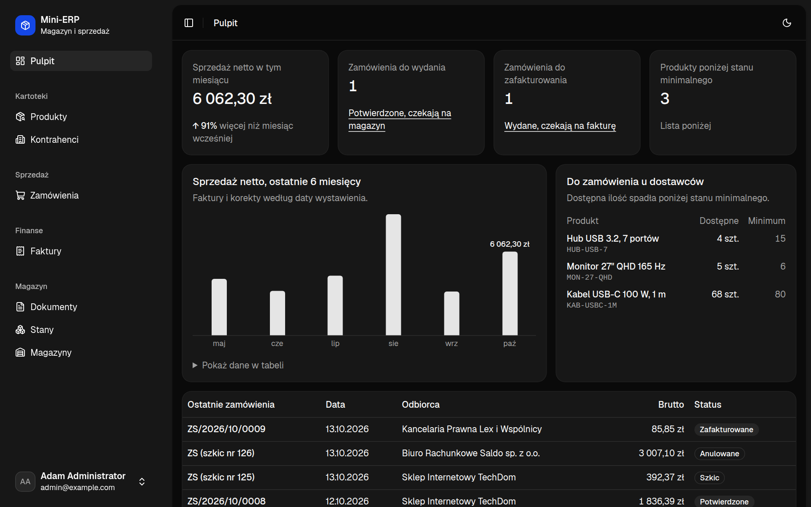
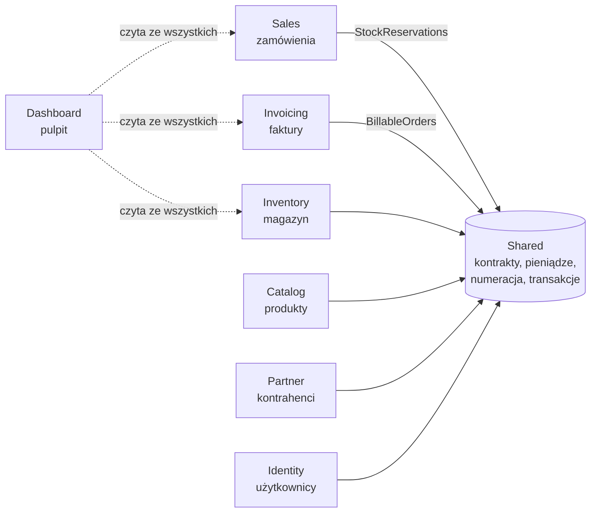

# Mini-ERP

System do obsługi sprzedaży hurtowej: od przyjęcia towaru, przez zamówienie i wydanie, po fakturę VAT. Modularny monolit w Symfony 8.1, napisany jako projekt do portfolio.

Nie jest to zbiór formularzy CRUD. Pilnuje reguł, które w takim systemie naprawdę bolą: nie da się wydać towaru, którego nie ma, dwa jednoczesne wydania nie przejdą oba, zaksięgowanego dokumentu nie można zmienić, a faktura i jej korekty zawsze sumują się co do grosza.


| | |
|---|---|
|  |  |
| Zamówienie: pozycje, ceny z kartoteki i sumy odświeżane na żywo | Faktura z PDF-em generowanym w tle |
|  |  |
| Zaksięgowane przyjęcie towaru | Tryb ciemny |

## Co potrafi

Jeden proces, cztery role:

1. **Magazynier** przyjmuje dostawę dokumentem PZ. Zaksięgowanie zwiększa stany i nadaje numer.
2. **Handlowiec** wystawia zamówienie i je potwierdza. Potwierdzenie rezerwuje towar; jeśli go brakuje, system mówi, czego i ile.
3. **Magazynier** wydaje zamówienie. Rezerwacja zamienia się w zaksięgowany dokument WZ.
4. **Księgowa** wystawia fakturę VAT. PDF powstaje w tle, a pomyłkę naprawia faktura korygująca.

Do tego kartoteki produktów i kontrahentów, przesunięcia między magazynami, historia ruchów każdego produktu i pulpit z tym, co czeka na każdą z ról.

**Administrator** zarządza kontami (zakłada, nadaje role, ustawia hasła, blokuje), zmienia dane firmy drukowane na fakturach i przegląda dziennik zdarzeń: kto i kiedy się zalogował, zaksięgował dokument, wystawił fakturę albo zmienił cenę produktu (razem z wartością przed i po).

## Architektura

Każdy moduł leży w `src/<Moduł>` i nie widzi encji pozostałych. Przechowuje tylko ich identyfikatory, a o resztę pyta przez interfejsy z `Shared`, które implementuje moduł-właściciel. Granic pilnuje Deptrac w `make lint`.



| Moduł | Zakres |
|-------|--------|
| `Identity` | logowanie, role, zarządzanie kontami, „Moje konto” |
| `Catalog` | produkty i usługi, ceny, stawki VAT, stany minimalne |
| `Partner` | kontrahenci (odbiorcy i dostawcy), walidacja NIP |
| `Inventory` | magazyny, dokumenty PZ/WZ/MM, rejestr ruchów, stany, rezerwacje |
| `Sales` | zamówienia sprzedaży i ich cykl życia |
| `Invoicing` | faktury VAT, korekty, PDF, dane firmy |
| `Dashboard` | pulpit i dziennik zdarzeń; jedyny moduł, który czyta ze wszystkich |
| `Shared` | kontrakty między modułami, `Money`, VAT, numeracja dokumentów, transakcje, zapis dziennika zdarzeń |

Kontrakty: `ProductDirectory`, `PartnerDirectory`, `WarehouseDirectory` (odczyt kartotek), `StockReservations` (sprzedaż → magazyn), `BillableOrders` (faktury → sprzedaż).

## Reguły, których pilnuje kod

### Magazyn

- Dokument powstaje jako szkic i nie zmienia stanów. Zmienia je dopiero zaksięgowanie, po którym dokumentu nie da się edytować ani usunąć; pomyłkę naprawia dokument korygujący.
- Stan magazynowy jest sumą ruchów. Ruchy są tylko dopisywane, a stan jest aktualizowany w tej samej transakcji (`StockPosting`).
- Nie da się wydać więcej, niż jest dostępne (stan minus rezerwacje). Wiersze stanów są blokowane na czas księgowania, więc dwa jednoczesne wydania tego samego towaru nie przejdą oba.
- Numery (`PZ/2026/10/0001`) są nadawane przy księgowaniu, osobno dla typu i miesiąca, bez dziur: odrzucona operacja nie zużywa numeru.

### Sprzedaż

- Zamówienie przechodzi przez statusy z workflow `sales_order` (`config/packages/workflow.yaml`): szkic → potwierdzone → wydane → zafakturowane, z anulowaniem przed wydaniem.
- Każdy krok to jedna transakcja obejmująca zamówienie i magazyn (`OrderLifecycle`). Anulowanie zwalnia rezerwację.
- Ceny i stawki VAT są kopiowane na pozycję, więc późniejsze zmiany w kartotece nie zmieniają zamówienia.
- Formularz zamówienia to Live Component (`App\Sales\Twig\OrderEditor`), bez własnego JavaScriptu.

### Faktury

- Jedna faktura na wydane zamówienie. Wystawienie to jedna transakcja: numer, zapis faktury i zmiana statusu zamówienia.
- Faktura jest migawką: sprzedawca, nabywca, pozycje i sumy są na nią kopiowane i już się nie zmieniają.
- Faktura korygująca zmniejsza ilości i pokazuje „było / jest / różnica”. Jej VAT to różnica między VAT-em dokumentu przed i po, dzięki czemu faktura i korekty zawsze sumują się co do grosza.
- PDF generuje worker Messengera. Wiadomość trafia do kolejki w tej samej transakcji bazy co faktura, a strona sama odświeża status, aż plik będzie gotowy.

### Konta i administracja

- Nie ma osobnego modułu „admin”. Każdy moduł dostarcza własne ekrany administracyjne, a menu „Administracja” tylko je grupuje dla roli administratora.
- Kont się nie usuwa, tylko blokuje: dokumenty i dziennik dalej na nie wskazują. Zablokowany użytkownik nie zaloguje się, a jego trwająca sesja kończy się przy następnym żądaniu. To samo dzieje się po zmianie hasła lub ról.
- Po pięciu nieudanych logowaniach na jedno konto z jednego adresu kolejne próby są odrzucane przez 15 minut, nawet z poprawnym hasłem (`login_throttling`). Blokada trafia do dziennika raz, a nie przy każdej następnej próbie.
- Administrator może zalogować się jako inny użytkownik („Zaloguj jako” na liście kont), żeby zobaczyć system jego oczami. Na każdej stronie widać wtedy pasek z powrotem do własnego konta, a dziennik zapisuje administratora: „Adam Administrator (jako Hanna Handlowiec)”.
- Administrator nie może zablokować siebie ani odebrać sobie roli, a w systemie zawsze zostaje przynajmniej jeden aktywny administrator.
- Dziennik zdarzeń obejmuje operacje na dokumentach, zmiany w kartotekach, konta i logowania (także nieudane). Zmiany w kartotekach zapisuje automatycznie nasłuch Doctrine (`AuditListener`) dla encji oznaczonych interfejsem `Audited`, więc żadna edycja go nie ominie.
- Wpis w dzienniku zdarzeń zapisuje się w tej samej transakcji co operacja, więc dziennik nigdy nie wspomina o czymś, co zostało wycofane.

### Pieniądze i ilości

- Kwoty są liczbami całkowitymi w groszach (`App\Shared\Money\Money`), ilości w tysięcznych częściach jednostki. Żadnych ułamków zmiennoprzecinkowych.
- VAT jest liczony od sumy netto w każdej stawce, z zaokrągleniem „od połowy w górę”, w jednym miejscu w kodzie.

## Uruchomienie

Wymagania: PHP 8.5, Composer, [Symfony CLI](https://symfony.com/download), Docker.

```bash
composer install
make up      # Postgres i Mailpit w Dockerze
make db      # baza i migracje
make demo    # dane demonstracyjne (czyści bazę deweloperską!)
make serve   # serwer; w tle przebudowuje CSS i obsługuje kolejkę
```

`make serve` wypisze adres, zwykle http://127.0.0.1:8000.

### Konta demo

Tworzy je `make demo`. Proste hasła, tylko do użytku lokalnego.

| Rola | E-mail | Hasło | Co może |
|---|---|---|---|
| Administrator | `admin@example.com` | `admin12345` | wszystko, w tym konta, dane firmy i dziennik zdarzeń |
| Magazynier | `magazyn@example.com` | `magazyn12345` | dokumenty magazynowe, wydanie zamówień, produkty |
| Handlowiec | `sprzedaz@example.com` | `sprzedaz12345` | zamówienia, produkty, kontrahenci |
| Księgowość | `ksiegowosc@example.com` | `ksiegowosc12345` | faktury i korekty, kontrahenci |

Każdy zalogowany może przeglądać wszystko; role decydują o tym, kto co zmienia.

Dane demo to pół roku pracy hurtowni elektroniki: dostawy, kilkadziesiąt zamówień i faktur, a na koniec kilka zamówień w toku i produkty poniżej stanu minimalnego. Bez danych demo własne konto założysz tak:

```bash
symfony console app:user:create ja@example.com "Jan Kowalski" --role=ROLE_ADMIN
```

## Jakość

```bash
make test    # PHPUnit: reguły domenowe, ekrany, Live Components, ładowanie danych demo
make lint    # PHPStan (poziom 8), Deptrac, PHP-CS-Fixer, lintery Symfony
make fix     # automatyczna poprawa stylu
```

Testy sprawdzają reguły tak, jak używa ich wywołujący: żądaniem HTTP albo wywołaniem serwisu na prawdziwej bazie. Każdy test działa w transakcji, która jest potem wycofywana. Te same polecenia uruchamia GitHub Actions (`.github/workflows/ci.yaml`).

## Technologie

- **Backend**: Symfony 8.1, PHP 8.5, Doctrine ORM, PostgreSQL 16, Workflow, Messenger.
- **Interfejs**: Twig, Symfony UX (Turbo, Stimulus, Live Components), Tailwind CSS 4 bez Node (AssetMapper). Komponenty Twig pochodzą z [Symfony UX Toolkit](https://ux.symfony.com/toolkit), z kitu odwzorowującego wygląd shadcn/ui; leżą w `templates/components/` i są częścią projektu. Kolejne dodaje `symfony console ux:install <komponent> --kit shadcn`.
- **PDF**: dompdf.

Blokady wierszy, numeracja i raport miesięczny korzystają ze składni PostgreSQL (`INSERT … ON CONFLICT`, `to_char`), więc inna baza wymagałaby zmian.

## Czego nie ma

Świadomie poza zakresem: księgowość i rozrachunki, płatności, wycena magazynu, wydania częściowe, korekta ceny na fakturze, wiele walut i wiele firm, KSeF.

Na produkcji worker kolejki trzeba uruchomić osobno (`symfony console messenger:consume async`, np. pod Supervisorem); `make serve` robi to tylko lokalnie.
